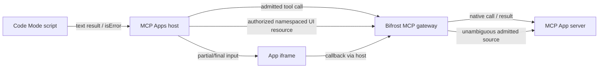

## Summary

Relay MCP Apps through direct, Virtual MCP and aggregate routes: preserve UI tool definitions, serve authorized HTML resources, route callbacks without ambiguous source selection, and forward the full native tool result. Preserve App metadata through config-store reload. Directly called Apps remain available with Code Mode enabled; scripts return text and do not create an App view.

Affected packages: core, config-store framework and HTTP transport, with changelogs and user documentation. Third contribution in A → B → C. Base B: `adb80e661560174025ff9f9c23b918cb377e14b9`; candidate C: `a369739b6c5c6cd0921bce4fa8e0b9a6ae6b6034`. Common upstream base: `transports/v2.2.6` (`8b4fce4f1709d66f9208d02f50552da522535f9e`). Fork distribution/version UI, CI, cloud setup, agent notes and QA captures are excluded from these contribution branches. Partial-input notifications originate at the host; the gateway does not generate model argument streams.

## Evidence

- **Before:** the pinned stock 2.2.6 comparison fails nine named feature sentinels while seven existing-behavior/positive fixture invariants pass. Flat cached tool rows lose `_meta.ui`; old flat rows remain readable by the new reader.
- **After:** [independent qualification 38715391307](https://github.com/sofianbll/bifrost/actions/runs/38715391307) builds C from its own immutable AMD64 checkout, separate from harness `1dcbd14d5875a14dc780f00fc2edd22cfaee66a8`. Go/UI/package-race/plugin probes pass, MCP reports 675 passed / 29 skipped / zero failures/errors, and C passes 39 exact wire cases / 149 assertions, Apps 80/80, reference-host 22/22, normalizer 10/10 and immediate/delayed initialization. This whole-stack result includes A/B; not every stock sentinel is attributed solely to C.
- The [integrated fork campaign](https://github.com/sofianbll/bifrost/actions/runs/38715303556) separately qualifies source `19362d86b2a3d17b699283c98f67861cbc6dc46c`, with AMD64/ARM64 MCP/build/image probes and the AMD64 wire/App gates. Independent A/B/C architecture coverage is AMD64.
- Four comparison legs use official Excalidraw `157aa23ceb1976008aadc89eb05e3444060f09d6` and corrected `4c3700f0ef25a261177fecad03284a57bf7847be`, each direct and via Bifrost, under official reference host `82221c0c8ce7661efa6771c9d461511b1650495f`. Intermediate one-/two-label renders are checked by controlled partial notifications. Corrected restore stays aligned in both routes; the official App reproduces the same expected restore defect in both. This Excalidraw correction is external to the gateway contribution.
- Actual pointer edit/save/read preserves seven elements and reciprocal text bindings at fixed framing. Deliberate +24/-20 text displacement is rejected. Direct/gateway geometry is equivalent before/after restore. Controlled host replay does not certify live-model streaming or native Codex.
- [Synthetic HTTP restart comparison](https://github.com/sofianbll/bifrost/actions/runs/38715406042) passes VK/JWT on stock/fork before/after two same-store restarts; it does not diagnose historical [#11](https://github.com/sofianbll/bifrost/issues/11). Durable earlier sanitized CI proof is [versioned on the fork](https://github.com/sofianbll/bifrost/tree/f9e80d6752ded0cee1a1700b2bdafea19c467f3d/docs/qa/bifrost-2.2.6/upstream-stack-ci-20261014); final newer captures remain local.

## Merge Danger

**Door:** two-way with a compatible store snapshot. **Blast Radius:** MCP discovery, results, resources, callbacks and cached tool metadata. The new reader accepts old flat rows, but stock binaries cannot read the new wrapped tool-cache format. A later authorized rollout must preserve a store backup; downgrade to stock requires restoring or rediscovering the old cache. Native Codex, live-provider behavior and production dogfood are unverified release gates. A newer upstream submission base requires separate compatibility qualification; no production rollout is part of this PR.
